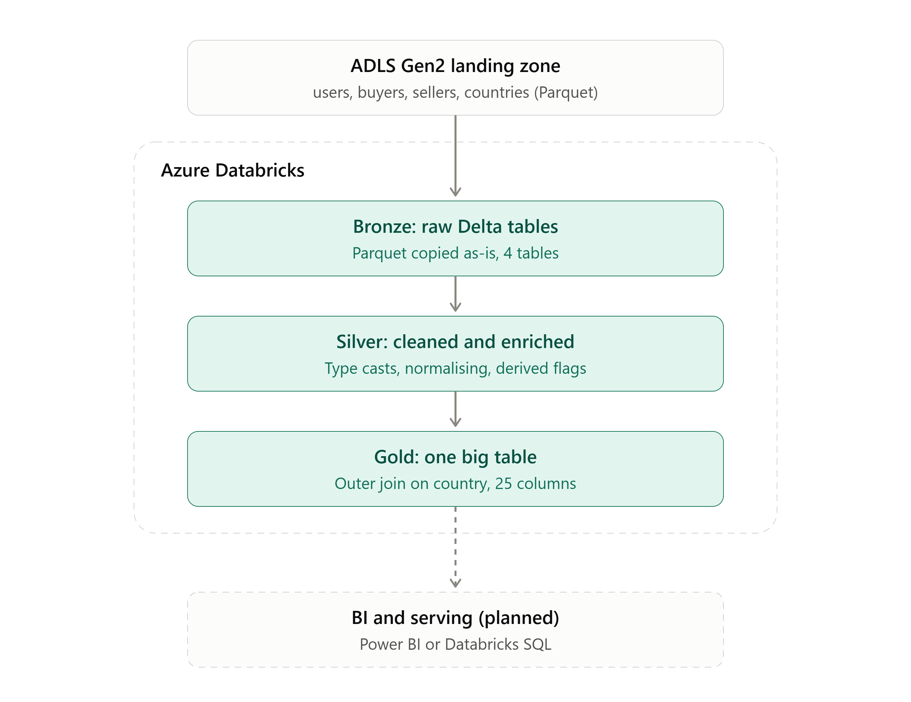

# Ecommerce-data-analysis-with-medallion

## E-commerce marketplace data pipeline (medallion architecture)

### Introduction

#### It is a batch data engineering pipeline on Azure Databricks. It ingests raw marketplace data about users, buyers, sellers and countries, cleans and enriches it, and builds one analytics-ready table.
#### Goal: analyzing who buys and sells on the platform and how activity differs by country, gender and account age. The data looks like a second-hand fashion marketplace dataset.

### Architecture

### Tech stack used

1.Azure Data Lake Storage Gen2 (landing zone and storage)

2.Azure AD service principal (OAuth) for authentication

3.Azure Databricks, with the container mounted via dbutils.fs.mount to DBFS

4.Apache Spark 3.4.1 / PySpark for transformation

5.Delta Lake as the storage format for all layers

6.Python notebooks, one per layer

### what have we done so far

#### 1. Bronze layer (raw ingestion)
Mounted the container landing-zone-2 at /mnt/ecomdata1, using a service principal.
Listed the four folders: users-raw-2, buyers-raw-2, sellers-raw-2, countries-raw-2.
Read each as Parquet and wrote it unchanged as Delta (overwrite mode) to /mnt/delta/tables/bronze/{users, buyers, sellers, countries}.

#### 3. Silver layer (cleaning and enrichment)

Users

Uppercased the country code.
Mapped gender to Male/Female/Other.
Added language_full, civilitytitle_clean, years_since_last_login and current_year.
Added account_age_years and account_age_group (New under 1 year, Intermediate 1–3, Experienced 3+).
Added the user_descriptor string and a flag_long_title flag.
Cast booleans, integers and decimals, and filled null dayssincelastlogin with 0.

Buyers

Cast integer and decimal columns and normalized country names with initcap.
Filled integer nulls with 0.
Derived female_to_male_ratio and wishlist_to_purchase_ratio, plus high_engagement and growing_female_market flags.

Sellers

Cast types, normalized country and sex, and added seller_size_category (Small/Medium/Large).
Added mean_products_listed_per_seller and a high_seller_pass_rate flag.
Filled null pass rates with the global mean.

Countries

Cast types and normalized country names.
Added top_seller_ratio, high_female_seller_ratio and performance_indicator (sold/listed) with a high_performance flag.
Added activity_level (Highly Active, Moderately Active or Low Activity, based on offline days).

All four were saved to /mnt/delta/tables/silver/....

#### 3. Gold layer (in progress)

Read the four silver tables.
Outer-joined users, countries, buyers and sellers on country into one wide table.
Selected and aliased about 25 columns, prefixed by source (Users_, Countries_, Buyers_, Sellers_).
Saved it as /mnt/delta/tables/gold/ecom_one_big_table.
Left unfinished: a cell with a typo'd CREATE OR REPALCE TABLE (a SyntaxError) and a stray DE.

### Issues we have noticed

Join problem in gold. The users table has no initcap on country (it holds raw French names like "Etats-Unis"), while the other tables are normalized. The Countries_* columns come back NULL in your output (e.g., Singapour), so the join isn't matching.

Row duplication. Joining user-level rows to country-level aggregates on country repeats the country metrics on every user row. Sellers is also split by sex, so each user row is repeated per sex. Aggregating to country level first would avoid this.

language_full bug. The data holds lowercase en/de, but the code compares to 'EN'/'FR', so every row becomes "Other". Lowercasing the column first fixes it.
civilitytitle_clean bug. The data is lowercase (mr, mrs) but the regex looks for Mme|Ms|Mrs, so it changes nothing.

Pass-rate order. In sellers, the high_seller_pass_rate flag is computed before nulls are filled with the mean, so null rows are labelled "Normal".
Unused imports. sum and avg are imported in gold but never used.

Unsafe division. top_seller_ratio and mean_products_listed_per_seller divide without guarding against zero.
